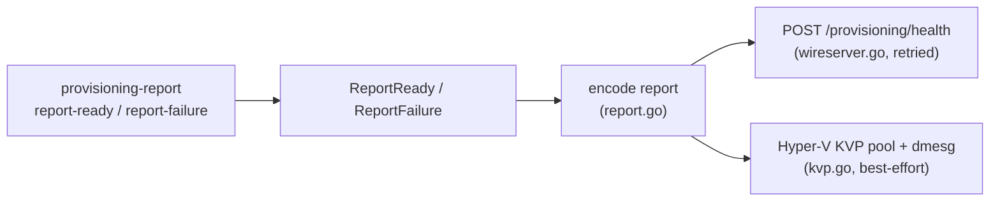

# Testing `provisioning-report`

A practical guide to how the `provisioning-report` tool works and how to test it — locally, in
automated tests, and on a real node. Share this with anyone who needs to validate the tool.

## What it does

`provisioning-report` reports an AKS node's provisioning outcome — **Ready** on success, or
**NotReady / ProvisioningFailed** on failure — to the Azure wireserver, and writes the same report
plus a `dmesg` snapshot to the Hyper-V KVP pool as diagnostics.

It is a thin CLI over the [`pkg/provisioning`](../../pkg/provisioning) package (`ReportReady` /
`ReportFailure`). It ships on the VHD at `/opt/azure/containers/provisioning-report`. It is a
standalone tool — `aks-node-controller` does **not** invoke it automatically (see
[reporting-rollout.md](../../pkg/provisioning/reporting-rollout.md) for the optional auto-reporting
path and how to add it back).



On each call the tool:

1. **Builds and encodes** a pipe-delimited report, e.g.
   `result=success|agent=AKS-CSE|pps_type=None|vm_id=<uuid>|timestamp=<rfc3339>`. The `vm_id` is read
   from `/sys/class/dmi/id/product_uuid` (falling back to `dmidecode -s system-uuid`, then the
   all-zero UUID).
2. **Posts it to the wireserver** (`POST http://168.63.129.16/provisioning/health`): Ready sends
   `{"state":"Ready"}`; failure sends `{"state":"NotReady","details":{"subStatus":"ProvisioningFailed","description":"<encoded>"}}`.
   Delivery is retried on `429`/`500`/`503` and transport errors up to the total retry budget
   (default 20m); any other non-`2xx` is fatal.
3. **Writes KVP diagnostics** (best-effort): the encoded report under key `PROVISIONING_REPORT` plus a
   `dmesg` snapshot, to `/var/lib/hyperv/.kvp_pool_1`. Disable with `--disable-kvp`.

> All commands below are run from the `aks-node-controller/` module root.

## 1. Run the automated tests

The package ships with unit and integration tests (encoding, wireserver retry/fatal behavior, KVP
record formatting, and end-to-end reporting against an in-process mock).

```bash
go test ./pkg/provisioning/... ./cmd/provisioning-report/...
```

Run the whole module (everything should pass):

```bash
go test ./...
```

## 2. End-to-end against the local mock wireserver

[`cmd/mockwireserver`](../mockwireserver) is a fake wireserver that records the reports it receives —
use it to exercise the real delivery path without touching the Azure fabric.

**Terminal 1 — start the mock:**

```bash
go run ./cmd/mockwireserver --addr 127.0.0.1:8899
```

**Terminal 2 — drive the CLI at it:**

```bash
# success report; also write KVP diagnostics to a temp file
go run ./cmd/provisioning-report report-ready \
  --endpoint http://127.0.0.1:8899/provisioning/health \
  --kvp-path /tmp/pr-kvp

# failure report with a reason and extra context
go run ./cmd/provisioning-report report-failure \
  --endpoint http://127.0.0.1:8899/provisioning/health \
  --reason "CSE failed with exit code 42" \
  --supporting-data exit_code=42 \
  --disable-kvp
```

The mock logs each report as it arrives:

```text
received provisioning report  state=Ready   subStatus=""                description=""
received provisioning report  state=NotReady subStatus="ProvisioningFailed" description="result=error|reason=CSE failed with exit code 42|agent=AKS-CSE|exit_code=42|pps_type=None|vm_id=...|timestamp=...|documentation_url=https://aka.ms/linuxprovisioningerror"
```

Both commands exit `0`. The commands are **fail-closed**: a non-zero exit means the report could not
be delivered within the retry budget (or an argument was invalid). Successfully reporting a *failure*
still exits `0` — the report itself was delivered.

## 3. Inspect the KVP diagnostics

`report-ready` above wrote KVP records to `/tmp/pr-kvp`. The pool uses fixed-width 512-byte key +
2048-byte value records (2560 bytes each), so a two-record file is 5120 bytes. View the readable
content:

```bash
ls -l /tmp/pr-kvp
strings /tmp/pr-kvp
```

You should see the `dmesg` key with a boot log snapshot and the `PROVISIONING_REPORT` key with the
encoded report:

```text
dmesg
[    1.245855] ...
PROVISIONING_REPORT
result=success|agent=AKS-CSE|pps_type=None|vm_id=00000000-0000-0000-0000-000000000000|timestamp=...
```

## 4. Build the binary the VHD ships

CI cross-compiles the binary with the Microsoft Go toolchain via the packer target:

```bash
# from the repo root; requires GOEXPERIMENT=ms_nocgo_opensslcrypto (Microsoft Go)
make -f packer.mk build-provisioning-report
# -> aks-node-controller/bin/provisioning-report-linux-amd64
# -> aks-node-controller/bin/provisioning-report-linux-arm64
```

Without the Microsoft Go fork you can still verify the build with the stock toolchain:

```bash
CGO_ENABLED=0 GOOS=linux GOARCH=amd64 go build -o bin/provisioning-report-linux-amd64 ./cmd/provisioning-report
./bin/provisioning-report-linux-amd64 --version
```

## 5. On a real node

The binary is installed on the VHD at `/opt/azure/containers/provisioning-report`. On an Azure Linux
node it can reach the real wireserver and the real KVP pool with no flags:

```bash
/opt/azure/containers/provisioning-report report-ready
/opt/azure/containers/provisioning-report report-failure --reason "bootstrap failed: <detail>"
```

Confirm the VHD image test covers it: `testProvisioningReportBinary` and
`testProvisioningReportVersion` in
[vhdbuilder/packer/test/linux-vhd-content-test.sh](../../../vhdbuilder/packer/test/linux-vhd-content-test.sh)
assert the binary exists and reports a valid version.

## Command reference

```text
provisioning-report report-ready   [flags]
provisioning-report report-failure [flags] --reason TEXT [--documentation-url URL] [--supporting-data k=v ...]
```

| Flag | Default | Description |
| --- | --- | --- |
| `--endpoint` | `http://168.63.129.16/provisioning/health` | Wireserver provisioning-health endpoint. |
| `--agent` | `AKS-CSE` | Reporting agent identifier (report `agent=` field and request headers). |
| `--total-retry-timeout` | `20m` | Total budget for delivering the report. |
| `--disable-kvp` | `false` | Do not write the report and `dmesg` to the Hyper-V KVP pool. |
| `--kvp-path` | `/var/lib/hyperv/.kvp_pool_1` | Override the Hyper-V KVP pool file path. |
| `--reason` / `--description` | required | Human-readable failure reason (`report-failure` only). |
| `--documentation-url` | `https://aka.ms/linuxprovisioningerror` | Documentation URL in the failure report. |
| `--supporting-data` | — | Extra `key=value` context, repeatable (`report-failure` only). |

**Exit codes:** `0` = report delivered; non-zero = delivery failed within the retry budget, or an
argument was invalid.

## See also

- [`pkg/provisioning/README.md`](../../pkg/provisioning/README.md) — protocol, retry, KVP, and API details.
- [`pkg/provisioning/reporting-rollout.md`](../../pkg/provisioning/reporting-rollout.md) — the optional automatic-reporting path and how to add it back.
