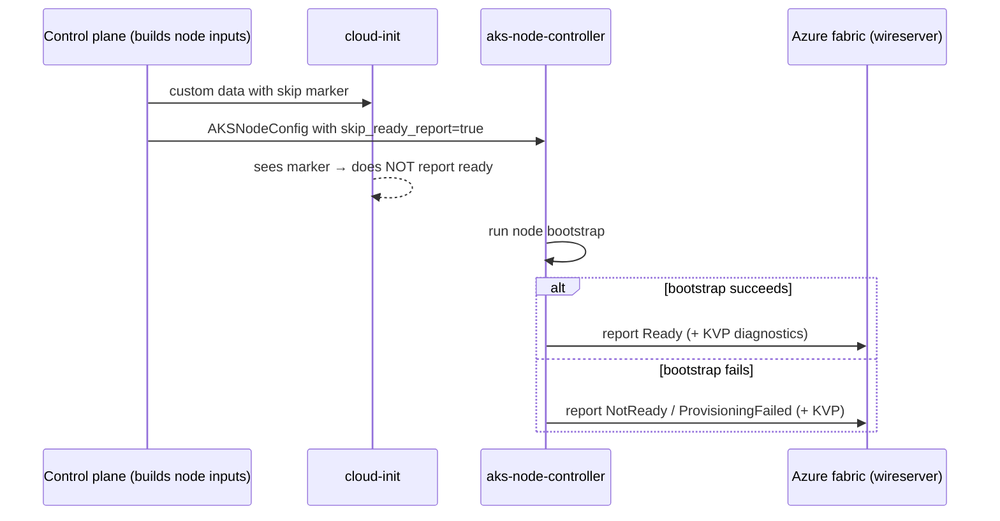

# Automatic provisioning-health reporting from `aks-node-controller` — re-add recipe

> **Status: NOT in the code today.** `aks-node-controller` does **not** report provisioning health
> automatically. The reporting *tools* (`pkg/provisioning` and the `provisioning-report` CLI shipped
> on the VHD at `/opt/azure/containers/provisioning-report`) are present and complete. This document
> is a recipe for re-adding the automatic path ("Option B") — it describes exactly what was built,
> then reverted, so it is easy to reinstate later.

## What exists today (the tools)

`pkg/provisioning` reports node provisioning outcome — **Ready** on success, or **NotReady /
ProvisioningFailed** on failure — to the Azure fabric (`http://168.63.129.16/provisioning/health`),
and writes **KVP diagnostics** (the encoded report plus a `dmesg` snapshot) to the Hyper-V guest KVP
pool. It is exposed two ways:

- **Go API** — `provisioning.ReportReady` / `provisioning.ReportFailure`.
- **Standalone CLI** — `provisioning-report report-ready | report-failure`, shipped on the VHD at
  `/opt/azure/containers/provisioning-report`.

See [README.md](README.md) for the protocol, flags, and KVP details. Nothing about the tools needs
to change to re-add automatic reporting; Option B only adds a *caller*.

## Why you'd re-add automatic reporting

By default cloud-init reports "node ready" to the fabric when *cloud-init* finishes. On an AKS node
that is too early: the real bootstrap (kubelet, containerd, etc.) may not be done, and if it later
fails the fabric was already told "ready". Making the ready/failure signal reflect the *real*
bootstrap outcome needs two things to agree:

1. cloud-init must **not** send its own ready report (else it fires too early), **and**
2. something must send the ready/failure report **at the right time** — after bootstrap succeeds or
   fails. `aks-node-controller` is the natural place, since it already runs the bootstrap.

### The coordination rule

The two halves must be turned on **together**, or the node is reported wrong:

| cloud-init skips its report? | aks-node-controller reports? | Result |
| --- | --- | --- |
| yes | yes | ✅ one accurate, well-timed report |
| yes | no | ❌ nobody reports ready → node looks stuck |
| no | yes | ❌ two reports; cloud-init's is still premature |
| no | no | current default (cloud-init reports at its own time) |

Option B introduces a node-config flag, `skip_ready_report`, as the on-switch. `aks-node-controller`
reports **only** when that flag is set, so normal nodes are unaffected (flag defaults to `false`).

## The recipe (what to add back)

Four pieces were removed; re-add them in this order.

### 1. Node-config flag: `Configuration.skip_ready_report`

Add a `bool` field to the top-level `Configuration` message in
[proto/aksnodeconfig/v1/config.proto](../../proto/aksnodeconfig/v1/config.proto). The next free
field number is **46** (highest in use was `enabled_features = 45`):

```proto
  // When true, this node defers its provisioning "ready" report: cloud-init skips its own
  // premature report and aks-node-controller reports Ready/Failure at the end of bootstrap.
  // Defaults to false, which preserves today's behavior (cloud-init reports at its own time).
  bool skip_ready_report = 46;
```

Then regenerate the Go bindings. The repo pins the toolchain in
[protoc.Dockerfile](../../protoc.Dockerfile) (protoc **28.3**, protoc-gen-go **1.35.2**); regen must
reproduce `pkg/gen/aksnodeconfig/v1/config.pb.go` deterministically. This yields the getter
`config.GetSkipReadyReport() bool` used below.

### 2. `app.go`: report at the end of provisioning

Re-add the import:

```go
	"github.com/Azure/agentbaker/aks-node-controller/pkg/provisioning"
```

Add a test-injectable options field to the `App` struct (zero in production → real wireserver + KVP
defaults):

```go
	// provisioningReportOptions overrides provisioning-health reporting for tests (endpoint,
	// KVP path, retry budget). Zero in production, using the real wireserver + KVP defaults.
	provisioningReportOptions provisioning.Options
```

Call the reporter from `runProvisionCommand`, right after `writeCompleteFileOnError` and only when
not a dry run:

```go
	provisionResult, err := a.runProvision(ctx, flags, dryRun)
	a.writeCompleteFileOnError(provisionResult, err)
	if !dryRun {
		a.reportProvisioningHealth(ctx, flags, provisionResult, err)
	}
	endTime := time.Now()
```

Add the three helpers. Reporting is **best-effort**: a report failure is logged and evented but never
changes the provisioning outcome. `readSkipReadyReport` fails open (returns `false`) so a normal node
keeps cloud-init's reporting. `provisioningFailureReason` trims the reason to 512 bytes.

```go
// reportProvisioningHealth reports provisioning success/failure to the Azure fabric when the node
// config's skip_ready_report is set (cloud-init skipped its own report). Best-effort: report
// errors are logged and evented but never change the provisioning outcome.
func (a *App) reportProvisioningHealth(ctx context.Context, flags ProvisionFlags, provisionResult *ProvisionResult, provisionErr error) {
	if !a.readSkipReadyReport(flags) {
		return
	}
	startTime := time.Now()
	var reportErr error
	var task string
	if provisionErr != nil {
		task = "ReportFailure"
		reportErr = provisioning.ReportFailure(ctx, a.provisioningReportOptions, provisioningFailureReason(provisionErr, provisionResult))
	} else {
		task = "ReportReady"
		reportErr = provisioning.ReportReady(ctx, a.provisioningReportOptions)
	}
	endTime := time.Now()
	if reportErr != nil {
		a.eventLogger.LogEvent(task, fmt.Sprintf("provisioning-health report failed: %s", reportErr.Error()), helpers.EventLevelError, startTime, endTime)
		slog.Error("provisioning-health report failed (continuing)", "task", task, "error", reportErr)
		return
	}
	a.eventLogger.LogEvent(task, "Completed", helpers.EventLevelInformational, startTime, endTime)
	slog.Info("provisioning-health reported", "task", task)
}

// readSkipReadyReport reads skip_ready_report from the provision config. It returns false when
// there is no config or it cannot be read/parsed, so a normal node keeps cloud-init's reporting.
func (a *App) readSkipReadyReport(flags ProvisionFlags) bool {
	if flags.ProvisionConfig == "" {
		return false
	}
	data, err := os.ReadFile(flags.ProvisionConfig)
	if err != nil {
		slog.Warn("could not read provision config for skip_ready_report; not reporting", "error", err)
		return false
	}
	config, err := nodeconfigutils.UnmarshalConfigurationV1(data)
	if err != nil {
		slog.Warn("could not fully parse provision config for skip_ready_report", "error", err)
	}
	return config.GetSkipReadyReport()
}

// provisioningFailureReason builds a trimmed failure reason from the provision error/result.
func provisioningFailureReason(provisionErr error, provisionResult *ProvisionResult) string {
	reason := provisionErr.Error()
	if provisionResult != nil && provisionResult.Error != "" {
		reason = provisionResult.Error
	}
	const maxReasonLen = 512
	if len(reason) > maxReasonLen {
		reason = reason[:maxReasonLen]
	}
	return reason
}
```

### 3. Tests

Re-add `app_reporting_test.go` covering the three helpers, using
`provisioningtest.NewMockWireserver()` and a temp `--kvp-path` via `App.provisioningReportOptions`:

- `TestReportProvisioningHealth` — reports Ready on success and NotReady/ProvisioningFailed on error
  only when `skip_ready_report` is set; asserts against the recorded mock requests; verifies a report
  failure does not change the provision outcome.
- `TestReadSkipReadyReport` — true only when the config sets the flag; fails open to `false` on
  missing/unreadable/unparseable config.
- `TestProvisioningFailureReason` — prefers `provisionResult.Error`, falls back to the error, trims
  to 512 bytes.

### 4. Cross-team coordination (the on-switch)

Automatic reporting only turns on for a node when **both** halves are set together:

- **cloud-init (already supported).** cloud-init skips its own ready report when the node's custom
  data opts in — a `# azure-experimental-node-ready` boothook marker line, or a
  `datasource: {Azure: {experimental_skip_ready_report: true}}` cloud-config block.
- **node config (the new flag).** The control plane must set `Configuration.skip_ready_report = true`
  in the same node's `AKSNodeConfig` whenever it enables the cloud-init skip. This is the piece the
  control plane team owns; it is a single boolean populated alongside the marker they already set.

Without the config flag, `aks-node-controller` deliberately stays out of the way, so existing nodes
are unaffected.

## Sequence (with automatic reporting on)



## Alternative: no new config field

If adding a control-plane field is undesirable, the same effect can be achieved without
`skip_ready_report` by pairing the two halves inside the custom data AKS already controls:

- Have the cloud-init boothook that sets the skip marker also **invoke the `provisioning-report` CLI**
  (shipped at `/opt/azure/containers/provisioning-report`) from a `runcmd` at the right time — no
  config flag and no `aks-node-controller` change, at the cost of timing the call correctly relative
  to bootstrap.
- Or have the boothook write a small **sentinel file** and have `aks-node-controller` read that
  instead of the config flag (co-locates both halves in custom data, no new typed field).

The config-flag recipe above is the most explicit and least fragile; these variants trade the typed
contract for keeping both halves in the custom data.
